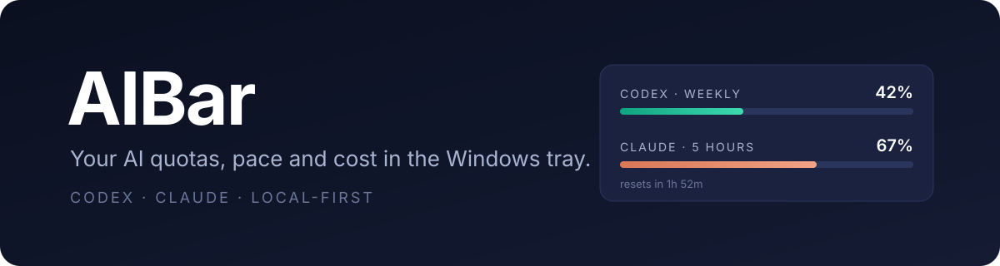

<p align="right">
  
  <a href="./README.es.md"></a>
</p>

<div align="center">


# AIBar

</div>

<div align="center">

[](https://github.com/MarsSall/aibar/actions/workflows/ci.yml)
[](./LICENSE)
[](https://github.com/MarsSall/aibar/stargazers)
[](https://github.com/MarsSall/aibar/issues)
[](https://github.com/MarsSall/aibar/commits/main)

</div>



Your AI quotas at a glance: Codex and Claude subscription usage, pace, resets and estimated cost, in the Windows tray.

## What is it

AIBar is a small local Windows tray app for people who live inside ChatGPT Codex and Claude Code. It shows how much of your 5-hour and weekly limits you have used, how fast you are burning through them and when they reset, without opening each provider's usage page.

Everything runs on your machine. AIBar reads the existing official CLI logins read-only, never refreshes or rewrites tokens, and keeps its history in local SQLite files.

> **Status: private beta.** The current build is `0.1.0-beta.4`, an unsigned, self-contained Windows x64 ZIP. There is no installer, updater or public release yet. See [private beta distribution](./docs/private-beta.md).

## Stack

<div align="center">
<a href="https://github.com/Gentleman-Programming/gentle-ai">
  
</a>
</div>

<div align="center">


</div>

## Quick start

AIBar targets **Windows x64**. You need the [.NET SDK 8.0.408](https://dotnet.microsoft.com/download/dotnet/8.0), pinned in [`global.json`](./global.json).

```powershell
git clone https://github.com/MarsSall/aibar
cd aibar
dotnet build AIBar.sln
dotnet run --project src/AIBar.Desktop
```

AIBar starts in the tray. Enable Codex and Claude from the tray menu; each provider asks for its own consent and stays off until you accept it.

## Commands

| Command | Purpose |
| --- | --- |
| `dotnet build AIBar.sln` | Build every project |
| `dotnet test AIBar.sln` | Run the .NET test suite |
| `dotnet run --project src/AIBar.Desktop` | Run the tray app from source |
| `python -m unittest discover -s tools/claude-remote-usage/tests` | Test the Linux remote-usage helpers |
| `pwsh -File scripts/Publish-Deterministic.ps1 -PrivateBeta ...` | Build the private-beta ZIP ([details](./docs/private-beta.md)) |

## Features

- **Quota panel.** Codex and Claude 5-hour and weekly windows, with reset countdowns, plan and freshness. Opens from the tray or a global show command. See [panel details](./docs/panel-details.md).
- **Pace and history.** Records each successful retrieval locally and projects whether you will run out before the reset. See [quota history](./docs/quota-history.md).
- **Estimated cost and tokens.** Today and the last 30 days, from local Codex CLI logs plus the optional remote helpers, priced at list price. These are estimates, not invoices. See [usage cost](./docs/usage-cost.md).
- **Alerts.** Reset, threshold (default 75/90/100%) and "runs out before reset" notifications, with optional confetti and edge-glow effects. See [alerts](./docs/alerts.md).
- **Provider status.** Incident badges from the official status pages and one-click links to each provider's usage page. See [provider status](./docs/provider-status.md).
- **Copy summary.** Puts the displayed quota on the clipboard as plain text. See [quota summary](./docs/quota-summary.md).
- **Settings.** Follows Windows light, dark and high-contrast themes; opacity, provider tint, bar colors, alert thresholds and refresh interval. Fully keyboard accessible. See [settings](./docs/settings.md).
- **Floating widget.** No YASB? Enable an always-on-top quota-ring strip in Settings, or accept the one-time startup offer. Drag it to any screen edge.
- **YASB font.** AIBar offers to install the bundled IosevkaTerm Nerd Font when YASB is detected and the font is missing. You can also install it from Settings (per user, no admin or download).
- **YASB widget.** Optional [YASB](https://github.com/amnweb/yasb) CustomWidget that shows a sanitized quota snapshot in your status bar. See [`yasb/README.txt`](./yasb/README.txt).
- **Remote usage.** Optional Linux helpers send Claude quota and Codex token aggregates from another machine over SSH. See [`tools/claude-remote-usage`](./tools/claude-remote-usage/README.md).

### Supported providers

| Provider | Data | Connection |
| --- | --- | --- |
| ChatGPT Codex | 5-hour and weekly limits, local token usage | Existing Codex CLI login (`auth.json`), read-only |
| Claude Pro / Max | 5-hour and weekly limits, token usage | Existing Claude Code login, read-only, or a helper on another machine |

Quota retrieval uses undocumented provider endpoints. They may change or stop working at any time.

## Architecture

| Path | Responsibility |
| --- | --- |
| `src/AIBar.Domain` | Pure policies: pace, projection, alerts, pricing, derived metrics |
| `src/AIBar.Application` | Providers, credential boundary, SQLite stores, scanners, coordinators |
| `src/AIBar.Desktop` | WPF tray host, panel, settings, notifications, theming |
| `tests/` | xUnit suites and process harnesses |
| `tools/` | Packaging supervisor and the Linux remote-usage helpers |
| `yasb/` | YASB CustomWidget reader, examples and Pester tests |
| `scripts/` | Deterministic private-beta publishing |

Developer and test-design notes live in [`docs/dev/`](./docs/dev/README.md).

## Privacy and local data

- Each provider is **off by default** and needs its own explicit consent. Disabling a provider stops its polling and clears its cached quota.
- Credentials are read only from the official CLI login files. AIBar never refreshes tokens, changes a login or stores credentials of its own.
- Data stays under `%LOCALAPPDATA%\AIBar`: quota cache, history, analytics and the YASB snapshot. There is no AIBar backend and no telemetry.
- Requests go straight from your PC to OpenAI, Anthropic and their public status pages.
- **Clear AIBar Data** in the tray removes local caches, history and exports.

## Roadmap

Code signing, an installer, auto-update and a public release are planned, not current capabilities.

## Contributing

Issues and pull requests are welcome. Read [CONTRIBUTING.md](./CONTRIBUTING.md) for setup, tests and the PR flow, and [SECURITY.md](./SECURITY.md) to report vulnerabilities privately.

## License

[MIT](./LICENSE) © MarsSall. AIBar is not affiliated with OpenAI or Anthropic. Trademarks belong to their respective owners.

---

<div align="center">

**⭐ If AIBar is useful to you, consider giving it a star ⭐**

</div>
